# What classifier-free guidance does inside SiT

This document collects every result so far, in the order the experiments were run. Each part says what was asked,
what was done, what came out, and how sure we can be. Questions asked along the way are answered in
**Clarification** boxes where they fit. How to run the code is in [README.md](README.md).

**Short version.** Classifier-free guidance makes samples more recognizable but less varied. Here it does so mostly
in the first 30% of sampling, by pushing every sample of a class toward a shared "class direction". That push decides
the image's layout. Later guidance sharpens the object without changing the layout. Removing only that shared push
early (score-space damping) restores the lost layout variety while keeping about 97% of the gain in recognizability.
Weakening the class signal at the network's input (condition-space damping) restores more semantic variety, but only
by rewriting the network's internal class signal directly. Combining the two works best.

---

## Contents

1. [Background](#1-background)
2. [Is guidance on in SiT?](#2-is-guidance-on-in-sit)
3. [Which model, and can we trust its weights?](#3-which-model-and-can-we-trust-its-weights)
4. [First measurement: the guidance vector over time](#4-first-measurement-the-guidance-vector-over-time)
5. [Engineering side questions: images and MLX](#5-engineering-side-questions-images-and-mlx)
6. [w = 4 vs w = 1: what guidance does, step by step](#6-w--4-vs-w--1-what-guidance-does-step-by-step)
7. [Inside the network: rank, subspaces and spread](#7-inside-the-network-rank-subspaces-and-spread)
8. [Correcting for scale](#8-correcting-for-scale)
9. [When does guidance matter? Windowed guidance](#9-when-does-guidance-matter-windowed-guidance)
10. [Interventions: removing only the shared push](#10-interventions-removing-only-the-shared-push)
11. [Mechanistic study: how each intervention works](#11-mechanistic-study-how-each-intervention-works)
12. [Limits and open questions](#12-limits-and-open-questions)

---

## 1. Background

**SiT** (Scalable Interpolant Transformer) generates 256 × 256 ImageNet images of a requested class. Like Stable
Diffusion, it works in a compressed **latent** space: each image is a 4 × 32 × 32 tensor that a separate decoder
(a VAE) turns into pixels. All analysis here happens on those latents or inside the network.

**Sampling as a path from noise to data.** Generation starts from Gaussian noise and moves step by step toward an
image. Time t runs from 0 (pure noise) to 1 (clean image). SiT uses a straight-line path between them:

> x_t = t · (image) + (1 − t) · (noise)

At each step the network predicts a **velocity** f(x_t, t, class), the direction to move, and the sampler takes a
small step along it. We use 49 fixed steps of equal size (Euler's method), so step k sits at t = k/49.

**Predicted clean image x̂.** On a straight path you can extrapolate from any point to where you would land:
x̂ = x_t + (1 − t) · f. This shows what the model "is aiming for" at each step.

**Classifier-free guidance (CFG).** The same network is trained both with the class label and without it (a special
"null" class). At sampling time it runs twice per step and combines the two answers:

> f_guided = f_uncond + w · (f_cond − f_uncond) = f_uncond + w · Δ

**Δ (the guidance vector)** is the difference between what the model does knowing the class and not knowing it,
so it points "toward the class". **w** is the guidance scale. At w = 1 you get the plain conditional model. At w = 4,
the setting used here, you go four times as far along Δ. Larger w makes samples more recognizable but less varied.
The goal of this project is to understand that trade-off.

**Seeds and classes.** Every batch samples the same 8 ImageNet classes: golden retriever, otter, lesser panda,
geyser, macaw, valley, balloon and arctic fox. A **seed** fixes the starting noise. Using the same seeds across
settings means each setting starts from identical noise, so differences come only from the setting.

**Two statistics used throughout:**

- **Cosine similarity** between two vectors measures whether they point the same way: 1 means the same direction,
  0 unrelated, −1 opposite.
- **Shared proportion** S across N samples: S = ‖mean of the vectors‖² / mean of each ‖vector‖². S = 1 when all
  samples are identical, and S ≈ 1/N when they are independent with no common part. Here, N = 16 seeds of one class,
  so "nothing shared" is about 0.0625.

---

## 2. Is guidance on in SiT?

> **Clarification: is classifier-free guidance enabled?** Yes in training and in the main sampling script, but not
> in the multi-GPU one:
>
> | Where | Default |
> |---|---|
> | Training | Labels are replaced by the null class 10% of the time, which is what makes CFG possible later |
> | `sit/sample.py` | w = 4.0 |
> | `sit/sample_ddp.py` | w = 1.0, so **off** |
> | `sit/train.py` preview images | w = 4.0 |
>
> **A quirk that matters later:** SiT's `forward_with_cfg` applies guidance to only **3 of the 4 latent channels**,
> for reproducibility with an earlier codebase. The 4th channel always uses the plain conditional prediction. Every
> experiment here keeps that behavior.
>
> **Correction:** I first said the model's learned-variance channels also skip guidance. In fact the model drops them
> before guidance is applied, so only the 4th latent channel is affected.

---

## 3. Which model, and can we trust its weights?

The task asked for SiT-L, the "large" size (458M parameters). The SiT authors only released the larger XL/2. A
community Hugging Face repository has an L/2 conversion, but its model card does not say who trained it. Before
relying on it, I ran four checks:

| Check | Result |
|---|---|
| File hash matches the one Hugging Face publishes | Yes |
| The same repo's XL/2 conversion matches the official XL/2 checkpoint | Bit-identical on all 292 parameter names and the 5 tensors compared, so the converter is faithful |
| Samples look like their classes | All 8 classes correct on seed 0, and all 64 images across seeds 0–7 at thumbnail size |
| Its velocity agrees with official XL/2 at the same inputs | Cosine ≥ 0.984. A randomly initialized model would be near 0. |

The weights are clearly trained and genuine SiT. Their exact training recipe is unknown, so cite them as a community
release. A side observation: the two models agree on velocity (≥ 0.984) but much less on Δ, the guidance vector (0.99
at t = 0, falling to 0.11–0.14 by the end). So the details of guidance may differ between models.

---

## 4. First measurement: the guidance vector over time

**Question.** How large is Δ, and does its direction change smoothly or jump around from step to step?

**Setup.** SiT-L/2, w = 4, seeds 0–7, 8 classes (64 trajectories). Velocity is the model's native output. For each
step, the size of the guidance ‖Δ_t‖ and its **direction stability**, the cosine between Δ at this step and the
previous one.

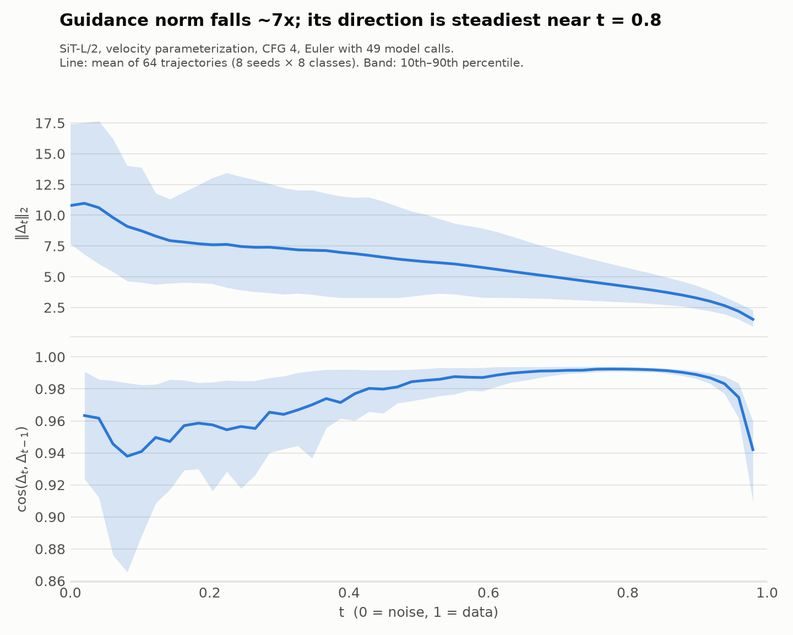

**Results.**

- **Size** peaks at 10.97 near the start and falls about 7× to 1.54 by the end.
- **Direction** is very stable throughout (cosine 0.94–0.99). It is steadiest around t ≈ 0.78 (0.992) and dips
  briefly at t ≈ 0.08 (0.938) and at the very end (0.942).

**Changing what Δ means doesn't change its direction.** Diffusion models can predict velocity, the noise ε, or the
clean image x̂. On this straight path, Δ in those other terms is just Δ_velocity times a positive number for each step
(t for noise, with a sign flip, and 1 − t for the clean image). So direction stability is the same whichever
prediction you use; only the size curve changes shape.

**Checks.** Rerunning gives bit-identical results. Rebuilding every step from the logged values matches to 5e-7. GPU
and CPU computations of Δ agree to 1e-5.

---

## 5. Engineering side questions: images and MLX

> **Clarification: where are the images?** The first run stored only latents. The final images were decoded
> afterwards: per-seed grids in `outputs/guidance_delta/SiT-L_2/samples/`. In later runs, sample grids are in each
> run's `analysis/samples/` (or `samples/`) folder.

> **Clarification: is this running on MLX?** No. Everything runs on PyTorch's Apple-GPU backend (MPS) in 32-bit
> floats. An MLX port exists in `bench/sit_mlx.py` from an earlier speed benchmark, but none of these experiments use it.

> **Clarification: can MLX run in 32-bit, and would it be faster?** Yes, and it is about 1.4× faster, but less
> accurate than the name suggests. Measured on SiT-L/2, one batch of 8 over 49 steps, median of 3 alternating runs:
>
> | Engine | Time | Speedup | Error in Δ vs PyTorch (most steps / last step) |
> |---|---|---|---|
> | PyTorch MPS, fp32 | 73.0 s | 1× | — |
> | MLX, fp32 | 50.8 s | 1.44× | 0.2–2% / 6.7% |
> | MLX, fp16 | 31.8 s | 2.3× | 0.8–3.5% / 11.6% |
>
> A plain matrix multiply on MLX's GPU in "fp32" had about 1,000× the error of a CPU one (7.7e-4 vs 5.7e-7 relative).
> Δ is a small difference between two similar outputs, which makes it sensitive to rounding. So every experiment stays
> on PyTorch, where Δ matches CPU to about 1e-5. An earlier attempt at this benchmark was invalid (a shell bug sent
> every run to PyTorch) and was discarded.

---

## 6. w = 4 vs w = 1: what guidance does, step by step

**Setup.** 16 seeds × 8 classes at both w = 4 and w = 1, from identical noise. Everything was logged at every step:
f_cond, f_uncond, x_t and x̂. Inside the network, every transformer block's output was logged as a **pooled**
1024-number vector (averaged over the image's 256 patches), plus the full 256 × 1024 **token** activations at blocks
4, 12 and 22 at 10 timesteps. Blocks are numbered from 0 to 23.

> **Clarification on two choices I made:** "layers 4, 12 and 22" are read as zero-indexed (`model.blocks[4]`, and so
> on). "Do this for both", which was cut off in the request, is read as logging both the conditional and unconditional
> passes.

Unless stated otherwise, cross-seed numbers use the 16 seeds of one class, averaged over the 8 classes.

### 6.1 Size and direction

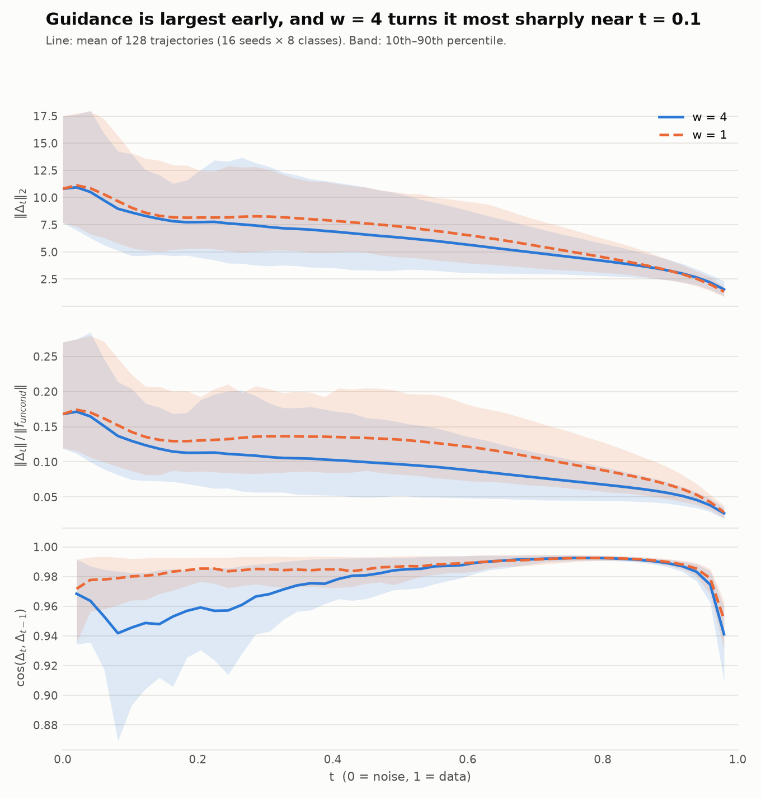

| | w = 4 | w = 1 |
|---|---|---|
| ‖Δ‖ near start → end | 10.9 → 1.55 | 11.1 → 1.35 |
| Guidance relative to the unguided prediction, ‖Δ‖/‖f_uncond‖, at t = 0.49 | 0.097 | 0.132 |
| Direction stability at t ≈ 0.08 | **0.942** | 0.979 |

The early direction change at t ≈ 0.08 mostly disappears at w = 1, so strong guidance itself causes it.

### 6.2 Seeds share a class direction only at the start

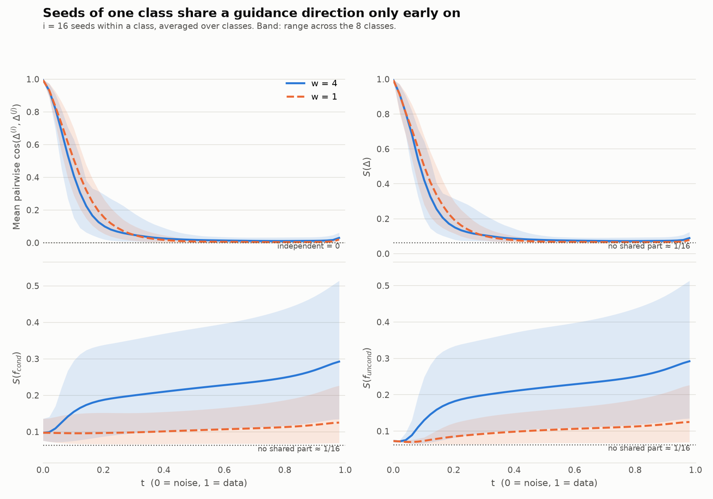

| | t = 0 | t = 0.12 | t = 0.49 | t = 0.98 |
|---|---|---|---|---|
| Cosine between seeds' Δ (w = 4) | 0.994 | 0.31 | 0.018 | 0.029 |
| S(Δ) (w = 4) | 0.994 | 0.33 | 0.079 | 0.089 |
| S(f_cond), w = 4 / w = 1 | 0.097 / 0.097 | 0.165 / 0.096 | 0.218 / 0.104 | 0.292 / 0.125 |

- **At t = 0, every seed of a class gets almost the same guidance vector** (cosine 0.994). This makes sense: from pure
  noise the model knows nothing about the specific image, so the best guidance is "class average minus overall
  average", the same for every seed. By t ≈ 0.5 the shared part is gone, and guidance has become specific to each seed.
- **The predictions themselves become about twice as shared at w = 4.** That is guidance making seeds converge.

### 6.3 Guidance moves from coarse to fine detail

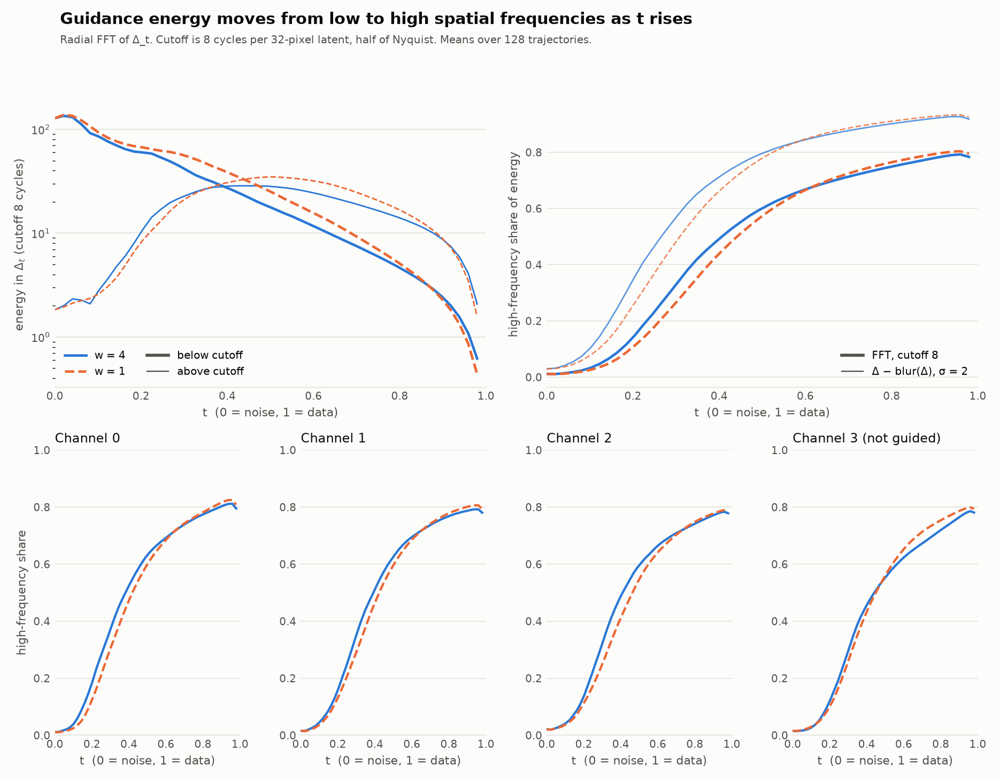

A 2D Fourier transform splits Δ into coarse patterns (low spatial frequency, such as layout and big shapes) and fine
patterns (high frequency, such as texture and edges). With a cutoff of 8 cycles across the 32-pixel latent:

- Early on, about 99% of Δ's energy is coarse. By the end, about 80% is fine.
- Fine energy overtakes coarse at t ≈ 0.41 for w = 4 and t ≈ 0.45 for w = 1.
- A simpler split, a Gaussian blur for the coarse part and what's left over for the fine part, shows the same pattern.

### 6.4 Guidance cuts diversity by more than half

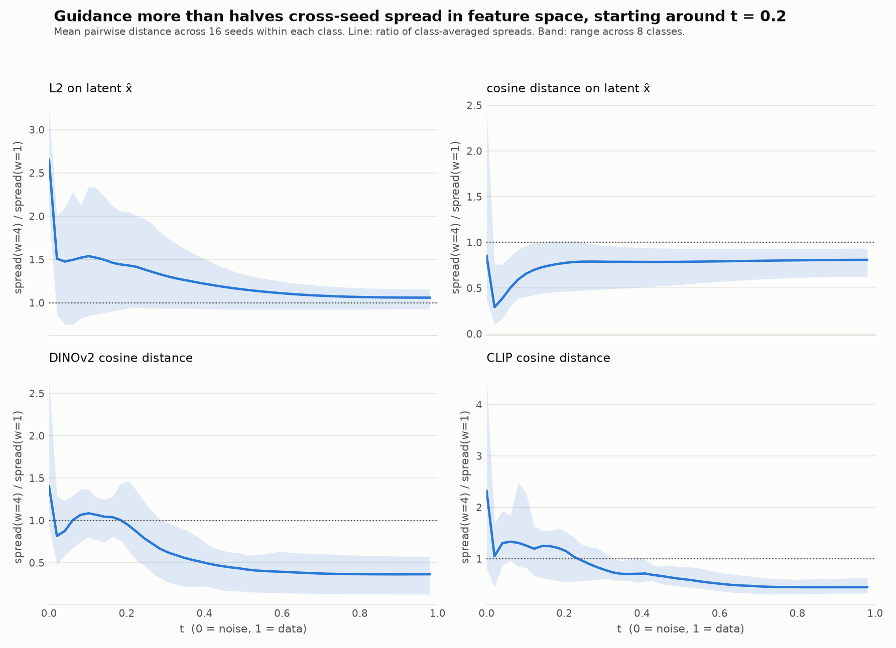

**Diversity** is measured as the average distance between different seeds' images of the same class. Raw pixels or
latents are a poor measure of whether two images look different, so images are also compared with **DINOv2** and
**CLIP**: pretrained vision networks that map an image to a vector, where similar-looking images get nearby vectors.

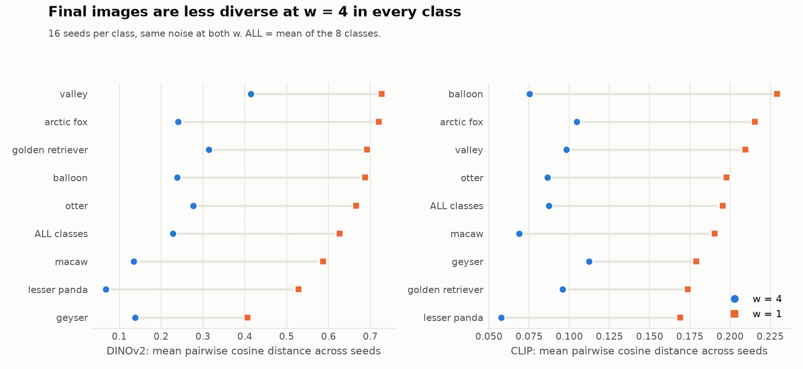

| Final images | w = 1 | w = 4 | Ratio (95% interval) |
|---|---|---|---|
| DINOv2 distance | 0.627 | 0.228 | **0.35** (0.32–0.38) |
| CLIP distance | 0.195 | 0.087 | **0.45** (0.42–0.48) |

Diversity drops in all 8 classes. The drop starts around t ≈ 0.2 and levels off by t ≈ 0.7.

**Plain distance (L2) on latents is misleading here.** It says w = 4 is slightly *more* diverse (ratio 1.06), only
because guided latents are about 20% larger overall (RMS 0.90 vs 0.75), and L2 grows with size. Comparing directions
instead of raw distances (cosine distance), w = 4 is less diverse (ratio 0.81).

---

## 7. Inside the network: rank, subspaces and spread

These analyses ask how the variation between seeds is organized inside the network.

**Effective rank** counts how many independent directions the variation between seeds really uses. Stack the 16
seeds' feature vectors into a 16 × 1024 matrix, subtract the average row, and compute the singular values σ₁ ≥ σ₂ ≥ ….
Let p_k = σ_k² / Σσ², the share of variance in each direction. The effective rank is exp(entropy of p). If all
variation lies in one direction it is 1; if it is spread evenly over k directions it is k. With 16 seeds it can be at
most 15.

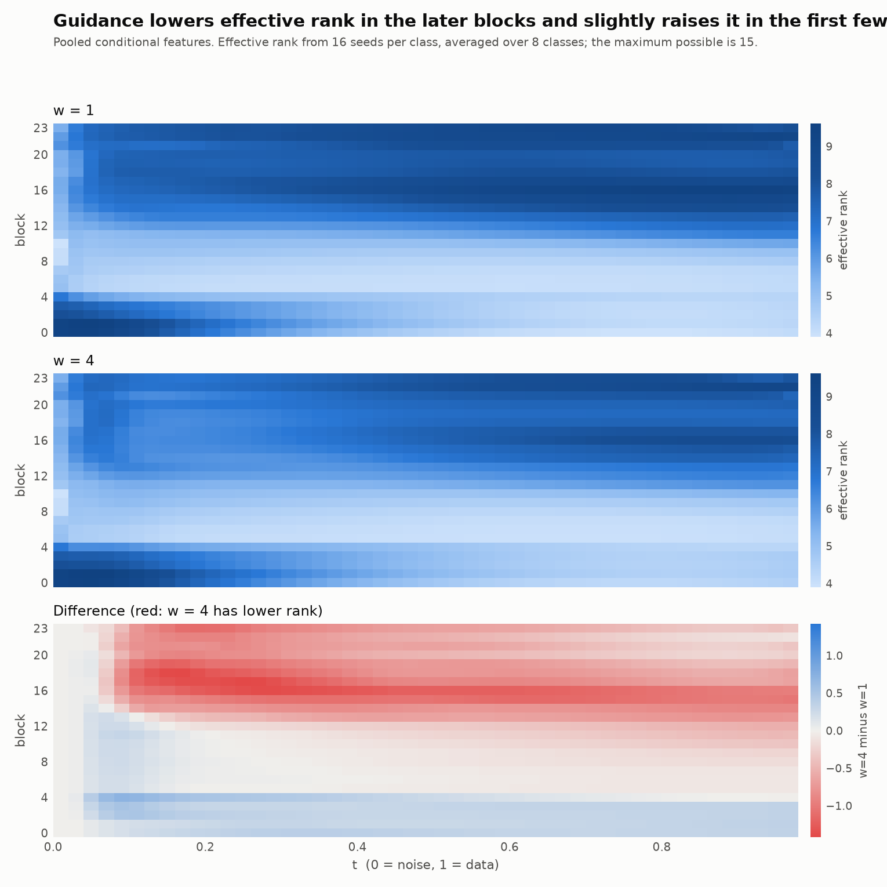

- **w = 4 lowers effective rank in the later blocks (13–23)**, by up to about 1.4 out of about 8.5, and raises it
  slightly in blocks 0–4.

**Does the variation subspace rotate or just shrink?** Principal component analysis finds the top 5 directions of
seed-to-seed variation at w = 1 and at w = 4. The angles between those two sets show whether guidance turns the
variation in new directions (rotation) or keeps the same directions but makes them smaller (shrinking).

Even two random halves of seeds at the *same* w don't give identical subspaces, so that sets the ceiling for "no
rotation". Comparing w = 1 with w = 4 on different seeds against that ceiling, averaged over 20 random splits:

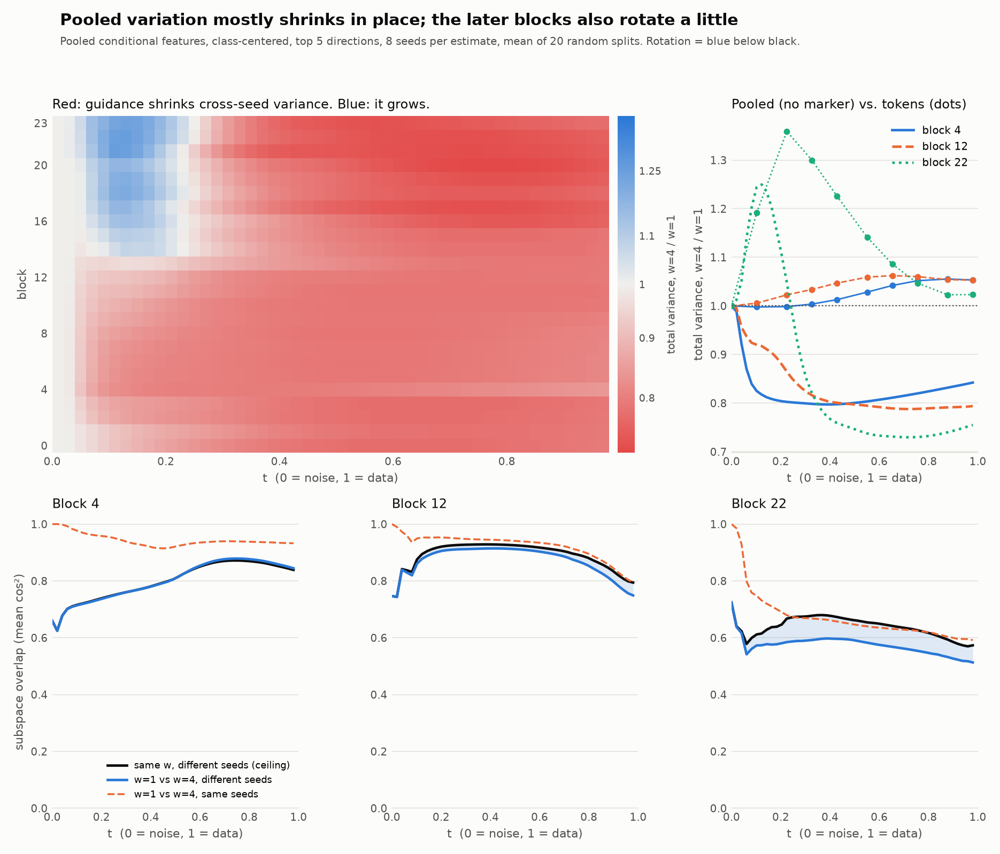

| Blocks | Overlap lost to rotation |
|---|---|
| 0–8 | about 0 |
| 12 | 0.02 |
| 16–23 | 0.05–0.07, positive in nearly every split |

So variation **mostly shrinks in place, with a modest rotation in the later blocks**. Total variation in the pooled
features at w = 4 is 0.75–0.81× its w = 1 level.

**Which directions shrink.** Measured on seeds held out from fitting the directions, for t > 0.3, the ratio of
variance along each w = 1 direction (w = 4 / w = 1):

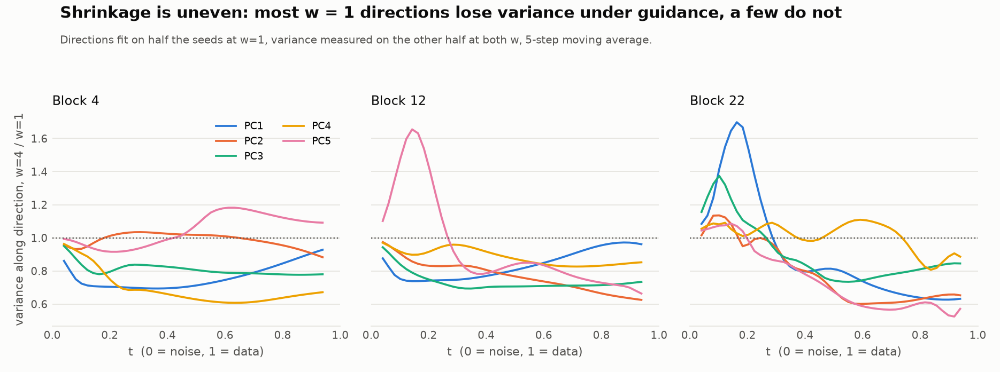

| Block | PC1 | PC2 | PC3 | PC4 | PC5 |
|---|---|---|---|---|---|
| 4 | 0.78 | 0.98 | 0.80 | 0.64 | 1.09 |
| 12 | 0.87 | 0.72 | 0.71 | 0.86 | 0.77 |
| 22 | 0.72 | 0.68 | 0.80 | 0.98 | 0.65 |

Most directions lose 20–35% of their variance, but a few do not shrink at all.

**Token activations were less informative.** With only 16 seeds and 262,144 numbers per token map, effective rank is
stuck near its maximum of 15, and even identical inputs give almost no subspace overlap. Subspace conclusions
therefore rest on the pooled features.

---

## 8. Correcting for scale

**Question.** Variance ratios can mislead if guidance simply makes activations larger or smaller. Are the results
above real or a scale effect?

**Scale-free spread.** Divide the variance by the average squared size of the vectors: V = variance / mean ‖h‖². This
equals 1 − S, and is unchanged if every vector is multiplied by the same number.

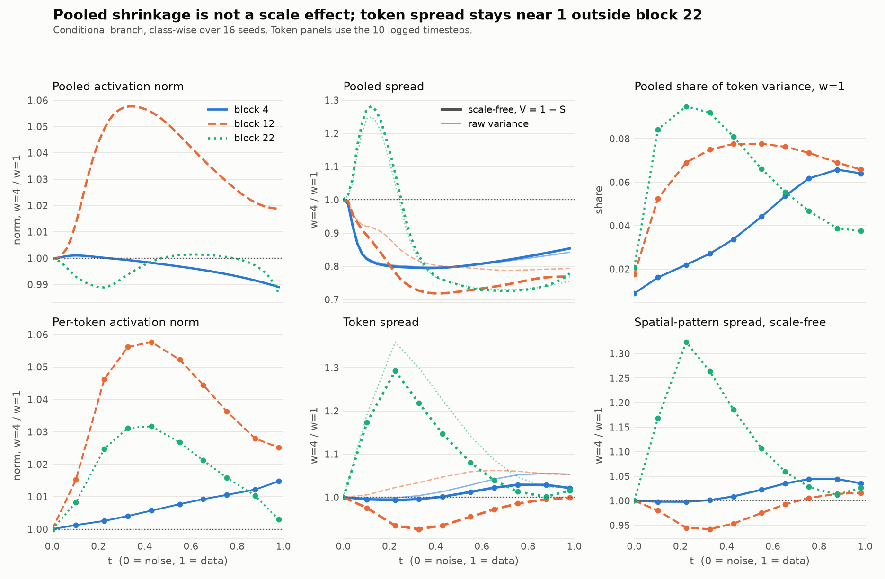

| | Raw ratio (w = 4 / w = 1) | Scale-free ratio | Activation size change |
|---|---|---|---|
| Pooled features, t > 0.3 | 0.78 | **0.77** | at most 6% |
| Token features, t > 0.3 | 1.07 | **1.02** | at most 6% |

- **The pooled shrinkage is real**, not a scale effect.
- **The tokens' apparent "no shrinkage" was partly scale.** For example, block 12's token spread is at or below 1
  once scale is removed.
- **Why pooled and token features disagree.** The pooled part of a token map, the average shared by all 256 patches,
  is only **2–9% of its variation between seeds**. The other 91–98% is the spatial pattern: which patch has which
  feature. That spatial part changes little with guidance (within about 6% at blocks 4 and 12). Block 22 is the
  exception, where it briefly grows to 1.32× around t ≈ 0.22.

**Raw variance does not actually fall in the latents.** For the final latents' coarse patterns, variance across seeds
rises slightly (904 → 1115) while the class-average component grows 4.5× (210 → 942). The scale-free spread falls
because **guidance adds a large shared class vector on top of the existing variation**, not because the variation
itself collapses. This finding shaped the interventions in part 10.

---

## 9. When does guidance matter? Windowed guidance

**Hypothesis.** Early strong guidance removes global variation, such as layout and which kind of image appears. Late
strong guidance removes finer appearance and texture variation.

**Test.** Two new runs on the same seeds and noise: guidance w = 4 **only for t < 0.3** (steps 0–14) and w = 1 after,
and the reverse, w = 4 **only for t ≥ 0.3**. Each run was checked to match its reference exactly up to the switch.
For each measure, **share reproduced** = how much of the full w = 4 effect the window alone produces (0 = like w = 1,
1 = like w = 4).

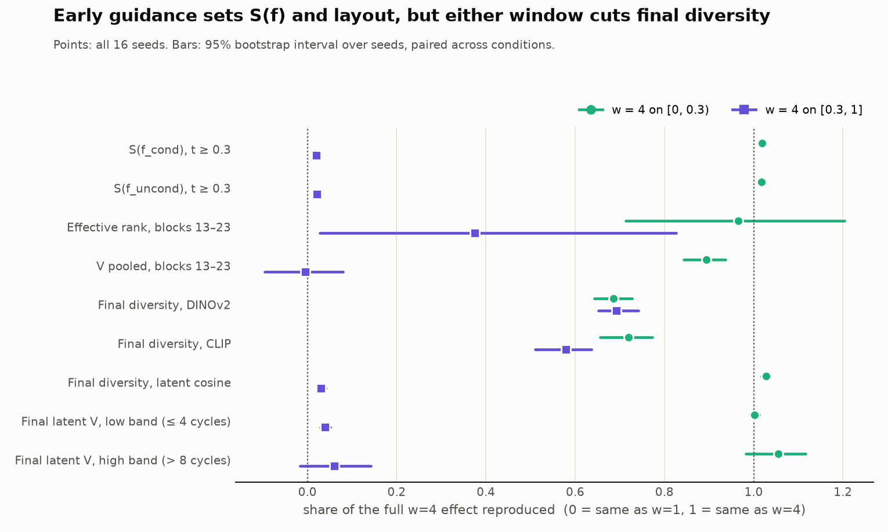

| Measure | Early only, t < 0.3 | Late only, t ≥ 0.3 | Prediction |
|---|---|---|---|
| S(f_cond), shared predictions | 1.02 | 0.02 | Holds |
| Effective rank, blocks 13–23 | 0.97 (wide interval) | 0.37 | Mostly holds |
| Pooled spread, blocks 13–23 | 0.89 | −0.01 | Holds |
| Final latent diversity (cosine) | 1.03 | 0.03 | Holds |
| Final DINOv2 diversity | 0.69 | **0.69** | **Fails** |
| Final CLIP diversity | 0.72 | **0.58** | **Fails** |

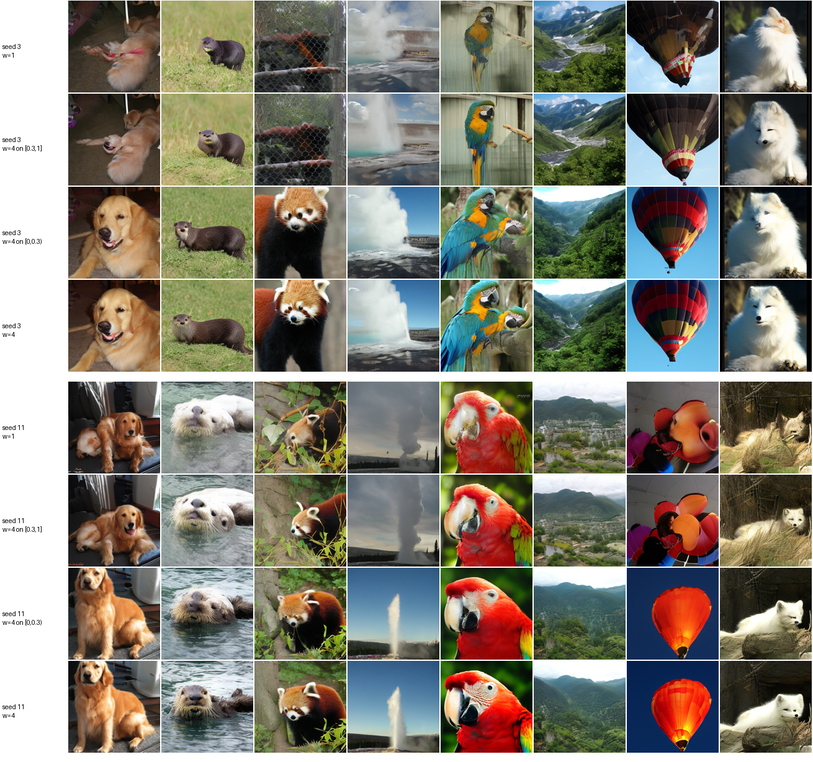

- **The first half of the hypothesis holds.** Layout is essentially decided by t = 0.3. An early-window image keeps
  w = 4's layout almost exactly (coarse-pattern distance 0.009), and a late-window image keeps w = 1's (0.026). Two
  different seeds differ by 0.6–0.9 on the same measure.
- **The second half is only partly right.** Late guidance changes each image's appearance without touching its
  layout, often fixing a malformed object. That makes images more alike to DINOv2 and CLIP, but it does not make
  their textures more alike in the latents. Some of this late "diversity loss" may really be a quality gain; with no
  quality metric, that can't be confirmed.
- The two windows' effects multiply roughly independently (DINOv2: 0.56 × 0.56 ≈ 0.32 predicted, 0.36 actual).

---

## 10. Interventions: removing only the shared push

**Goal.** Keep w = 4's recognizability but recover lost diversity, by changing guidance only for t < 0.3.

**Fair comparison.** Every method uses the same compute: 2 network passes per step, 98 in total. Directions are fit on
seeds 0–15 and every method is tested on **new seeds 16–31**, so it can't benefit from fitting the test data.

**How recognizable images are (fidelity)** is measured by how confident an ImageNet classifier is that each image
shows its intended class. This is a stand-in: proper image-quality scores (FID) need real ImageNet photos, which
weren't available.

> **Clarification: what are the methods?** Guidance can be split into a w = 1 part plus an "excess":
> f = f_cond + (w − 1) · Δ. Most methods damp only the excess, so full strength (λ = 1) lands near w = 1 rather than
> at no guidance.
>
> | Method | What it changes for t < 0.3 | Needs fitting? |
> |---|---|---|
> | **Scalar** (the control) | Just lowers w: λ = 0.5 means w = 2.5, λ = 1 means w = 1. Damps every direction equally. | No |
> | **Score** | Removes the excess guidance only along each class's shared direction. The direction is found by averaging Δ over the fitting seeds (which cancels each seed's own part) and keeping the top 3 directions, which hold 94–99.5% of it. This removes about 98% of Δ at t = 0 but only about 5% by t = 0.29, as Δ becomes seed-specific. | Yes |
> | **Frequency** | Removes the coarse (low-frequency) part of the excess guidance. | No |
> | **Condition** | Pulls the class embedding fed into the network toward the null class's embedding. | No |
> | **Feature** | Inside blocks 13–23, removes the shared class component of the pooled activations. | Yes |
> | **Wrong class** (control) | Score, but using another class's directions. | Yes |
>
> The "score" method works the same in score, noise or velocity terms, because on this path they differ only by a
> scale factor at each step.

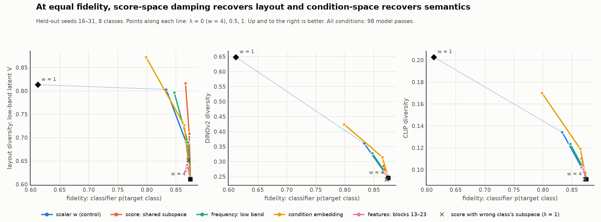

**Recovery** = share of the diversity lost at w = 4 that comes back. **Retention** = share of the fidelity gain kept.

| Condition | Layout recovery | DINOv2 recovery | CLIP recovery | Fidelity retention |
|---|---|---|---|---|
| Scalar, λ = 1 (w = 1 early) | 0.95 | 0.28 | 0.38 | **0.84** |
| **Score, λ = 1** | **1.01** | 0.10 | 0.17 | **0.97** |
| Frequency, λ = 1 | 0.92 | 0.20 | 0.29 | 0.89 |
| **Condition, λ = 0.5** | 0.57 | **0.17** | **0.25** | 0.96 |
| Condition, λ = 1 | 1.29 | 0.44 | 0.70 | 0.71 |
| Feature, λ = 1 | 0.09 | 0.05 | 0.10 | 0.97 |
| Wrong class, λ = 1 | 0.20 | −0.01 | 0.00 | 0.99 |

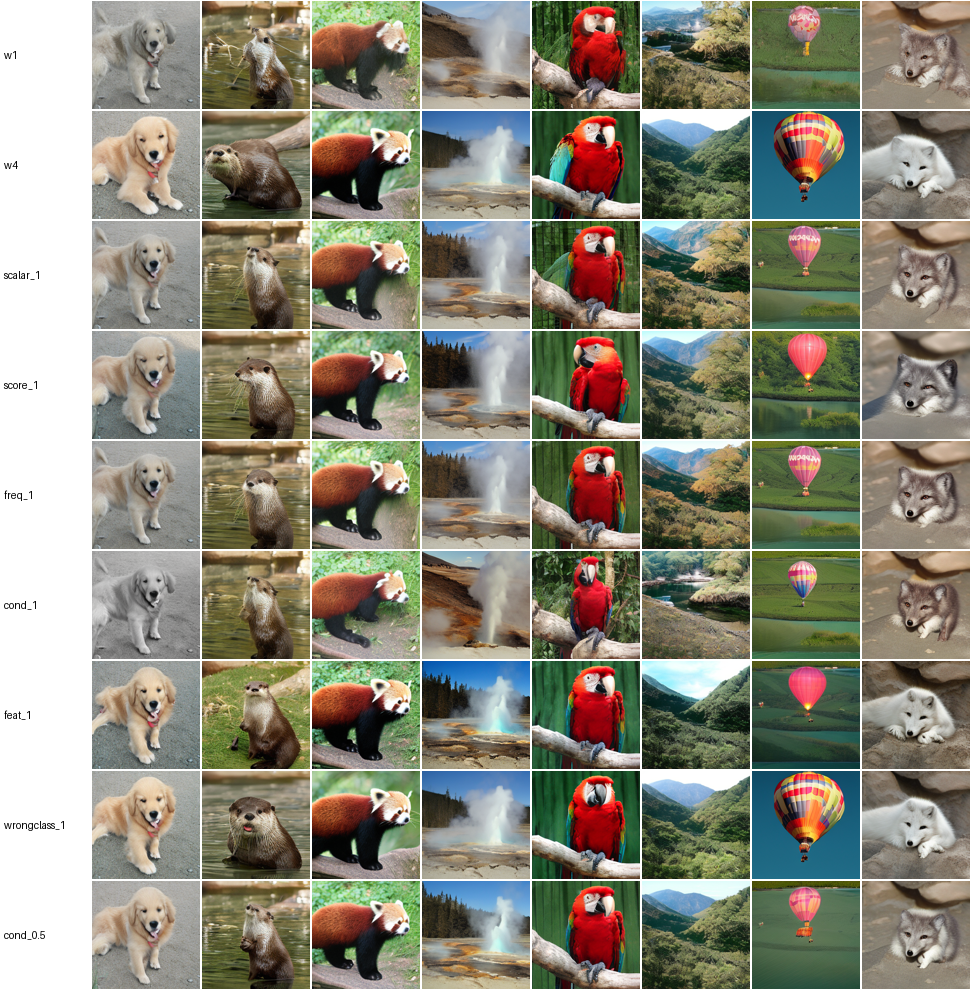

- **Score damping restores layout almost for free.** It recovers all the lost layout diversity while keeping 97% of
  the fidelity gain. Simply lowering w early recovers about as much layout but keeps only 84%. At equal fidelity,
  score gives 0.816 layout diversity versus the scalar control's 0.694.
- **Targeting the right class matters.** With another class's directions, layout recovery drops from 1.01 to 0.20.
- **Condition damping is best for semantic variety at equal fidelity**, but at full strength it loses fidelity. In
  one sample it turns a golden retriever gray.
- **Frequency damping behaves almost like lowering w,** because early guidance is nearly all coarse anyway.
- **Feature damping did not help,** consistent with the pooled component being only 2–9% of token variation.

---

## 11. Mechanistic study: how each intervention works

**Question.** What changes inside the network when score or condition damping is applied, and at what strength?

**Setup.** The full logging from part 6, rerun on seeds 16–31 for 10 conditions: w = 1, w = 4, score at λ = 0.5, 1
and 2, condition at λ = 0.25, 0.5 and 1, and two mixes (score λ = 1 plus condition λ = 0.25 or 0.5).

The **class signal** in a block is the pooled conditional activation minus the pooled unconditional one: the part of
the network's internal state that depends on knowing the class.

> **Clarification: which intervention acts where?**
>
> | Intervention | Where it acts |
> |---|---|
> | **Condition** | **Inside the network.** A hook changes the class embedding before the forward pass, so every block computes something different. |
> | **Score** | **Outside the network.** The model runs normally; afterwards part of the guidance is subtracted from the velocity the sampler uses. The network's computation is untouched. |
> | **Mix** | Both. |

> **Clarification: what do "direct" and "through x_t" mean?** They are the two routes by which an intervention can
> change the network's activations:
>
> 1. **Direct:** it changes how the network processes a given input. Same x_t in, different activations out.
> 2. **Through x_t:** it changes which x_t the network receives, because earlier steps moved the sample somewhere
>    else. The unchanged network naturally reacts differently to a different input.
>
> To separate them, take the activations at one step in three ways:
>
> | Label | What it is |
> |---|---|
> | A | The intervened run's own activations: intervened x_t, intervention on |
> | B | Recomputed: the same intervened x_t, run through the **plain** network |
> | C | The w = 4 run's activations: its own x_t, no intervention |
>
> **Direct = A − B** (same input, only the intervention differs). **Through x_t = B − C** (same network, only the input
> differs). They add up exactly to the total, A − C. This is a standard "activation patching" move from
> interpretability: hold one factor fixed and vary the other. Through-x_t isn't a separate intervention; it is the
> knock-on effect of either one.

### 11.1 Score works only through x_t; condition works directly

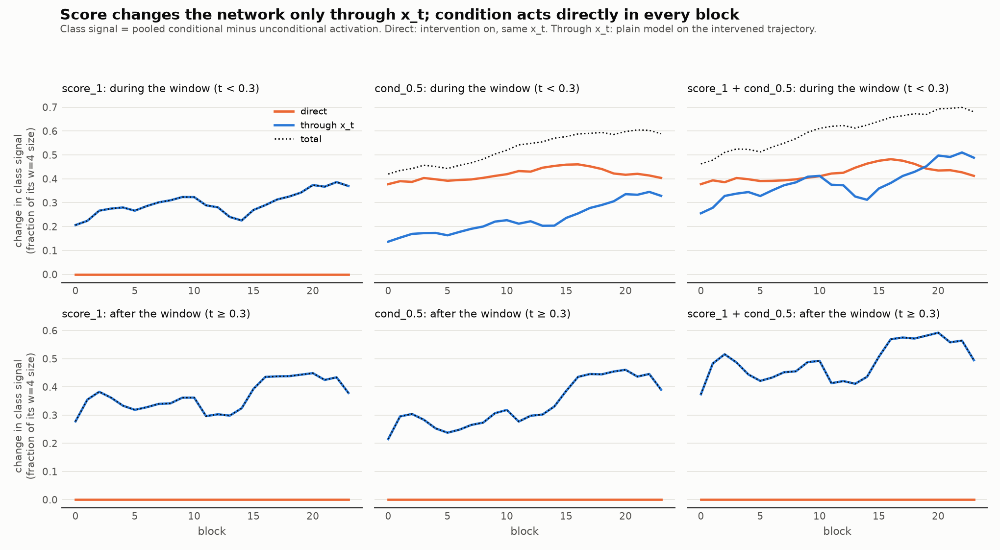

Values are the change in class signal as a fraction of its size at w = 4, averaged over blocks.

| Condition | During window: direct | During window: through x_t | After window (all through x_t) |
|---|---|---|---|
| Score, λ = 1 | **0 exactly** | 0.30 | 0.37 |
| Condition, λ = 0.25 | 0.22 | 0.12 | 0.20 |
| Condition, λ = 0.5 | 0.42 | 0.23 | 0.34 |
| Condition, λ = 1 | 0.77 | 0.43 | 0.58 |
| Score λ = 1 + condition λ = 0.5 | 0.42 | 0.38 | 0.49 |

- **Score never changes the network's computation.** All its internal effect comes from steering the sample elsewhere,
  and that alone changes the class signal by about 30%. The exact zero also confirms the decomposition is computed
  correctly.
- **Condition's direct effect grows in proportion to λ**, fairly evenly across blocks.
- **After the window, effects persist only through x_t**, fading slowly: for score λ = 1 it is 0.47 just after
  t = 0.3 and still 0.26 at the end. The network has no memory between steps, so x_t is the only way an early change
  can carry forward. The useful finding is how slowly it fades.

> **Clarification: how should m2 be read? Is a bigger change "more guided", or the model compensating for being
> "unguided"?** Neither, on its own. m2 is an **unsigned distance** from the w = 4 class signal: a value of 0.3 could
> mean 30% weaker, 30% stronger, or the same size pointing elsewhere. Checking the class signal's **size** separates
> these:
>
> | Condition | Size during window | Size after | Model's raw ‖Δ‖/‖f_uncond‖ after window |
> |---|---|---|---|
> | w = 4 | 22.9 | 19.1 | 0.080 |
> | w = 1 | 22.4 | 18.2 | 0.103 |
> | Score, λ = 1 | 22.6 | 18.9 | 0.085 |
> | Condition, λ = 0.5 | **13.2** | 18.1 | 0.084 |
> | Condition, λ = 1 | **4.5** | 18.1 | 0.092 |
>
> - **Condition's direct part is a weakening.** The class signal shrinks by about 42% at λ = 0.5, matching its direct
>   value of 0.42. Here, bigger change does mean less guided.
> - **Score's change is a redirection.** The signal stays the same size but points in a different direction for each
>   seed. That matches seeds sharing less of it.
> - **After the window, all conditions return to about the same size**, so the lasting change is mainly in direction.
> - **No clear sign of active compensation.** After the window the network's raw guidance is slightly larger on every
>   damped trajectory (0.084–0.092 vs 0.080), but w = 1 shows the same thing more strongly (0.103). The simplest
>   reading: the less a sample has committed to its class, the more the conditional and unconditional predictions
>   disagree, so the class pull is naturally bigger. That is a property of the sample, not the network correcting itself.
> - Splitting each change into a part along w = 4's class signal (stronger or weaker) and a part across it
>   (redirection) would answer this directly. That has not been run yet.

### 11.2 Score adds variation in few directions; condition in many

| Blocks 13–23, t ≥ 0.3 | w = 1 | w = 4 | Score λ = 1 | Condition λ = 0.5 | Condition λ = 1 |
|---|---|---|---|---|---|
| Scale-free spread V | 0.0155 | 0.0127 | **0.0154** | 0.0152 | 0.0165 |
| Effective rank | 8.20 | 7.25 | **7.46** | 7.63 | 8.49 |
| DINOv2 recovery | — | — | 0.10 | 0.17 | 0.44 |

Score brings back nearly all of the spread but only about 22% of the lost effective rank. The variation it restores
sits in a **few** dominant directions, which fits layout. Condition spreads variation over **more** directions, and
that tracks its semantic recovery. This is the most direct internal explanation so far for "score restores layout,
condition restores semantics". It is a correlation: it hasn't been tested whether those extra directions cause the
semantic differences.

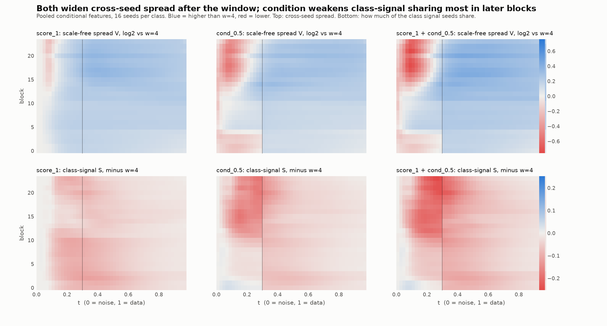

The two methods also act in different places. Score lowers how much seeds share the class signal mostly in blocks
1–12, condition mostly in blocks 12–23. During the window, condition briefly makes the late blocks *more* alike
across seeds, then less alike afterwards.

### 11.3 Dose response

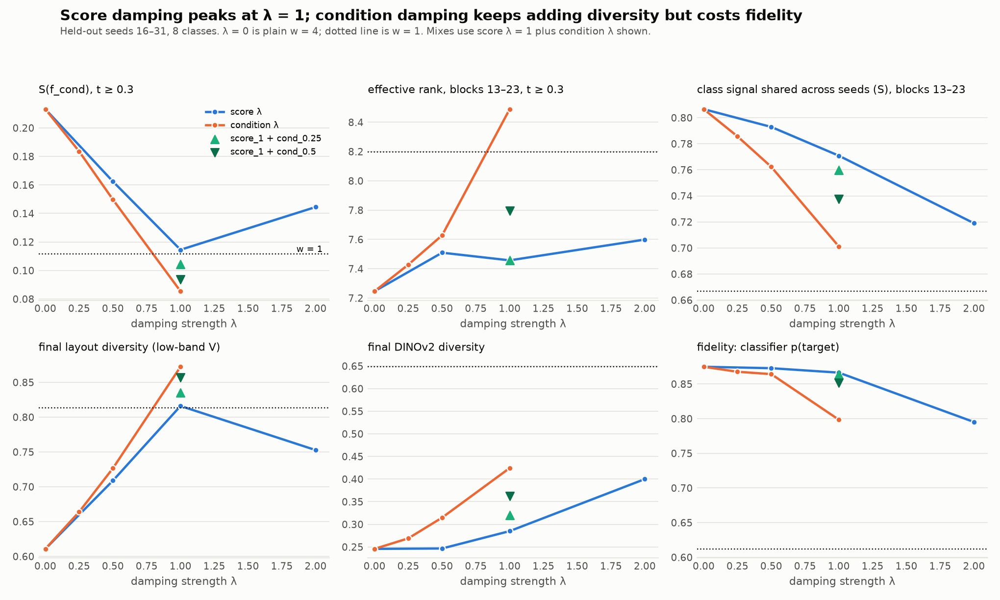

- **Score is best at λ = 1.** At λ = 2 it pushes *against* the class direction, and everything gets worse: shared
  predictions rise again (0.115 → 0.145), layout recovery falls (1.01 → 0.70), and fidelity retention drops to 0.70.
- **Condition at λ = 1 goes further than w = 1.** The method assumed the network responds linearly to the embedding,
  but its Δ shrank more than that, making effective guidance during the window about w = 0.83. That explains why it
  overshoots w = 1 on layout and shared predictions, and why it loses fidelity.

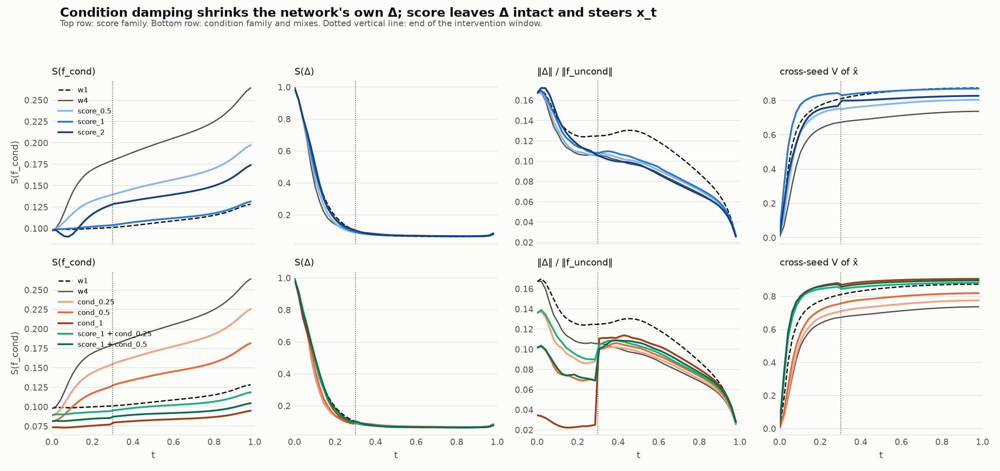

### 11.4 Mixing works best

| Condition | Layout recovery | DINOv2 | CLIP | Fidelity retention |
|---|---|---|---|---|
| Score, λ = 1 | 1.01 | 0.10 | 0.17 | 0.97 |
| Condition, λ = 0.5 | 0.57 | 0.17 | 0.25 | 0.96 |
| **Score λ = 1 + condition λ = 0.25** | **1.11** | **0.18** | 0.23 | **0.96** |
| Score λ = 1 + condition λ = 0.5 | 1.22 | 0.29 | 0.39 | 0.91 |

The first mix gets score's full layout recovery plus condition λ = 0.5's semantic recovery, at about the same
fidelity as either alone. It hasn't been compared against each single method with a direct paired test, and the
intervals overlap on fidelity.

---

## 12. Limits and open questions

**Limits that apply throughout:**

- **One model, one main guidance scale.** Only SiT-L/2 (community weights of unknown training recipe), mostly at
  w = 4, with one window boundary (t = 0.3) and fixed choices (rank 3, frequency cutoffs 4 and 8).
- **Fidelity is a proxy.** The classifier's confidence mostly saturates (top-1 accuracy 100% for most conditions) and
  misses visual problems like desaturation. There is no FID or precision/recall.
- **Internal conclusions mostly use pooled activations,** which are only 2–9% of token variation. The token-level
  data is logged but mostly unanalysed.
- **Correlation, not causation.** Links between internal measures (like effective rank) and image outcomes (like
  semantic diversity) are observed associations. They haven't been tested by ablation.
- **Bootstrap intervals are approximate:** they resample the same 16 seeds rather than drawing new ones.

**Open questions:**

1. Does the pooled-only picture hold at the token level?
2. Splitting each internal change into stronger, weaker and redirected parts, to answer the compensation question
   (section 11.1).
3. Recalibrating the condition method from the network's measured response instead of assuming linearity.
4. Testing causally whether the extra directions condition damping adds are what drive semantic diversity.
5. Adding a real image-quality metric, needed before trusting any of the semantic-diversity results.
